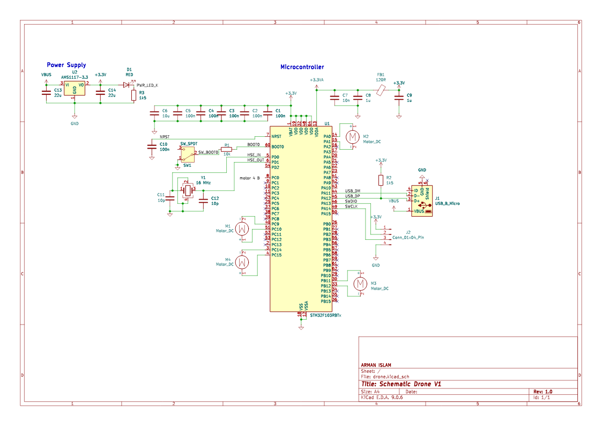

# drone

## Summary

Over the 2025 summer break, I decided to take on a project to build a drone (or in the most brutish terms to describe this project a "flying machine" ). This repository tracks all the code for the drone, written entirely from scratch (including drivers). No external libraries or HAL are used except the startup file and the linker file.

In short, this is a bare-metal quadcopter/drone project built entirely from the ground up.

## Current Limitations

- Project does not currently support RC Control (may be added in the future)
- The current timed PWM ramp has no altitude feedback and cannot ensure a safe landing

## Specifications

   Dimensions of the drone: 12x12x3 inches (to be updated as later revissions occur)
   Brushed DC motors
   LP9110s motor drivers
   F103RB microcontroler
   DJI Tello Propllers

## Planned Features

- Asserts & Cases to ensure safe operations
- RC Control

## Firmware

The firmware targets the STM32F103RB with a **16 MHz HSE crystal**. `SystemInit` runs the CPU and timer clocks at 72 MHz and APB1 at 36 MHz. `make` builds `build/drone.elf` and `build/drone.bin` with the Arm GNU toolchain.

Motor PWM is 20 kHz on PA0 (TIM2_CH1), PA10 (TIM1_CH3), PA6 (TIM3_CH1), and PA7 (TIM3_CH2). The corresponding LP9110 direction inputs are PA1, PA4, PB0, and PC1, held low. The mixer assumes the motors are wired in that order as front-left, front-right, rear-right, and rear-left, with alternating propeller rotation. Confirm the wiring, signs, and propeller rotation before attaching propellers. The MPU6050 uses I2C1 on PB8/PB9 at address 0x68 (AD0 low); the bus needs external pull-up resistors.

Startup reads the MPU6050 identity, configures its accelerometer and gyro, and calibrates gyro offsets from 200 stationary, level samples. Motors remain off by default. To opt into a **single** autonomous run, build with `make clean && make AUTOSTART=1`. The controller then holds a level attitude at a fixed PWM setting for 30 seconds, ramps PWM down over 3 seconds, and stops. Sensor errors, excessive tilt or rotation, or a late control-loop iteration stop the motors. The fixed PWM and controller gains in `src/app/autolevel.c` are initial values that require bench tuning.

There is no altitude sensor, battery monitor, or independent motor kill input. The timed PWM ramp cannot guarantee a controlled landing or altitude hold. Validate motor directions and controller response with propellers removed, then use a restrained test rig and an external power cutoff before considering free flight. `flight_arm()` is available for a future physical arming interface; the default build never calls it.

Host-side flight state tests: `make test` (requires Clang).
